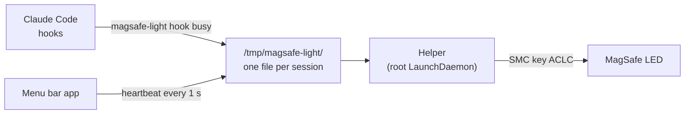

<div align="center">


# MagSafe Light

**Your MagSafe cable is now a status light for AI coding agents.**

See at a glance whether Claude Code is working, waiting for you, or done — right on the charging cable.

[](https://github.com/onelenyk/magsafe-light/actions/workflows/build.yml)
[](https://github.com/onelenyk/magsafe-light/releases/latest)
[](LICENSE)


**English** · [Українська](README.uk.md)

</div>

---

| LED | Meaning |
|:---:|---|
|  | **Working** — the agent is running |
|  | **Waiting for you** — permission prompt or a question |
|  | **Error** — the turn failed |
|  | **Done** — for 10 minutes, then back to normal |
|  | **No active sessions** — macOS shows charging as usual |

With several agents running, the most important state wins: error › waiting › working › done.

The hardware can only do green, orange and off, so that is the whole palette.

## Install

```sh
curl -fsSL https://raw.githubusercontent.com/onelenyk/magsafe-light/main/get.sh | sh
```

This downloads the latest release, verifies its checksum, puts **MagSafe Light** in Applications and starts it. On first launch it offers to:

1. **Install the helper** — asks for your password once (see [why](#how-it-works)).
2. **Connect Claude Code** — adds hooks to `~/.claude/settings.json` without touching your other hooks.

That's it: a light appears in the menu bar and the cable starts showing what your agent is doing.

**Requirements:** a Mac with MagSafe 3 (MacBook Air M2 or later, MacBook Pro 14″/16″ 2021 or later), macOS 13+.

<details>
<summary><b>Why a terminal command and not a download link?</b></summary>

MagSafe Light is free and is not signed with a paid Apple Developer ID. macOS quarantines apps downloaded by a browser and blocks unsigned ones; files fetched with `curl` are not quarantined, so the app just opens.

If you prefer to download [`MagSafe-Light.zip`](https://github.com/onelenyk/magsafe-light/releases/latest) manually: open the app, let macOS block it, then go to **System Settings → Privacy & Security → Open Anyway**. Or run:

```sh
xattr -dr com.apple.quarantine "/Applications/MagSafe Light.app"
```
</details>

<details>
<summary><b>Build from source</b></summary>

```sh
git clone https://github.com/onelenyk/magsafe-light.git && cd magsafe-light
make install-app      # needs Xcode Command Line Tools
```
</details>

<details>
<summary><b>Uninstall</b></summary>

```sh
curl -fsSL https://raw.githubusercontent.com/onelenyk/magsafe-light/main/get.sh | sh -s -- uninstall
```

Removes the hooks, the helper and the app, and hands the LED back to macOS.
</details>

## The menu bar app

The menu bar icon mirrors the current state. From the menu you can:

- see the LED state and every active agent session;
- **Enabled** — switch off to give the LED back to macOS;
- **Test LED** — cycle through all states, 3 seconds each;
- **Claude Code hooks** — connect or disconnect;
- **Helper** — reinstall or remove;
- **Launch at login**, **About**, **Quit**.

The LED shows agent state only while the app is running and enabled. Quit it, and within a couple of seconds the cable is back to its normal charging indicator. The interface is currently in Ukrainian.

## How it works



The LED is driven by the Mac's System Management Controller through the undocumented `ACLC` key:

| Value | Effect |
|:---:|---|
| `0` | macOS controls the LED |
| `1` | off |
| `3` | green |
| `4` | orange |

Only root may write to the SMC, and an agent hook can't ask for a password every time. So the tool is one dependency-free C binary with two roles:

- **`magsafe-light hook <state>`** — called by agent hooks, no root needed. Reads `session_id` from the event JSON on stdin and writes the state to a file. Prints nothing and always exits 0, so it never slows down or breaks the agent.
- **`magsafe-light daemon --require-app`** — the helper, running as root. Every half second it picks the most important state across sessions and drives the LED, including blinking. While the app's heartbeat is fresh, it re-asserts its color every 5 s, because macOS may override it (for example when charging state changes).

A state expires without updates — working after 20 min, waiting after 1 h, done and error after 10 min — so a crashed agent can't leave the light stuck.

### Claude Code events

| State | Events |
|---|---|
| working | `UserPromptSubmit`, `PostToolUse`, `PostToolUseFailure`, `PermissionDenied`, `ElicitationResult`, `PreCompact` |
| waiting | `PermissionRequest`, `PreToolUse` (AskUserQuestion), `Elicitation`, `Notification` (permission or question) |
| done | `Stop` |
| error | `StopFailure` |
| idle | `SessionEnd` |

Any other agent can be connected the same way: call `magsafe-light hook <state>` from its hook and pass the event on stdin. The session id is taken from `session_id` or `sessionId`.

## Command line

```sh
magsafe-light status            # sessions and what the LED shows
magsafe-light set busy          # set a state by hand (session "manual")
magsafe-light set idle          # remove it
magsafe-light clear             # remove all sessions
sudo magsafe-light led 3        # write ACLC directly
sudo magsafe-light blink 3      # test: green, orange, off
```

States: `busy`, `waiting`, `done`, `error`, `idle` (removes the session), `notification` (same as `waiting`).

Prefer no menu bar app? `./install.sh` installs the helper in always-on mode and `./install-hooks.sh claude` adds the hooks.

## Is it safe?

- It writes only one SMC key, `ACLC`, and only values 0–7. That key is purely an indicator and has no effect on charging.
- Nothing persists across reboots. If anything looks off: `sudo magsafe-light led 0` or re-plug the cable.
- The key is undocumented by Apple. Values come from open-source projects and are verified on an M4 Pro; a future macOS update could change them.
- Any local process can write a state into `/tmp/magsafe-light` and so change the LED color. Nothing else can be done through it.

See [SECURITY.md](SECURITY.md) for the details of the root helper.

## Tests

| Test | What it checks | Where |
|---|---|---|
| `make test` | state logic without touching the SMC: priority, expiry, `idle`, session names | every commit, GitHub Actions |
| `tests/e2e-claude.sh` | real Claude Code in tmux: prompt → Bash permission → approve → end of turn → `/exit` | by hand, needs a Claude login |
| `tests/e2e-app.sh` | real clicks through the menu bar app via System Events | by hand, needs Accessibility permission |

Latest `tests/e2e-claude.sh` run (Claude Code 2.1.302, MacBook Pro M4 Pro, macOS 26.3):

```
01:12:22 none
01:12:25 busy       prompt sent
01:12:27 waiting    Claude asks for Bash permission
01:12:30 busy       approved, command runs
01:12:31 done       end of turn
01:12:33 gone       /exit, session removed
ok   state sequence matches
```

## Related

- [AgentLight](https://github.com/onelenyk/agentlight) — the same idea as a standalone ESP32 desk lamp, with full color.

## License

[MIT](LICENSE) © onelenyk
