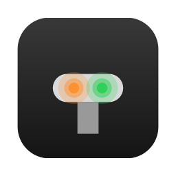
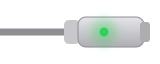
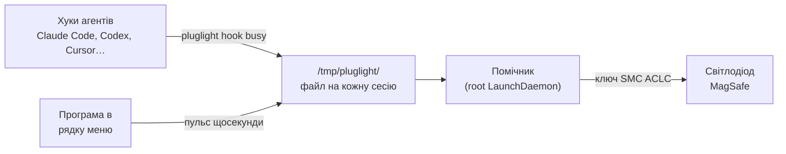

<div align="center">



# PlugLight

**Кабель MagSafe як індикатор AI-агента.**

Одним поглядом на зарядний кабель видно, чи Claude Code, Codex CLI, Cursor або ще один із п'яти підтримуваних агентів працює, чекає на тебе чи вже закінчив.

[](https://github.com/onelenyk/pluglight/actions/workflows/build.yml)
[](https://github.com/onelenyk/pluglight/releases/latest)
[](LICENSE)


[](https://onelenyk.github.io/pluglight/)

[English](README.md) · **Українська**

</div>

---

| Світло | Що означає |
|:---:|---|
|  | **Працює**: агент виконує задачу |
|  | **Чекає на тебе**: запит дозволу або питання |
|  | **Помилка**: хід завершився невдало |
|  | **Готово**: 10 хвилин, потім знову звичайна індикація |
|  | **Немає активних сесій**: macOS показує зарядку як завжди |

Якщо агентів кілька, показується найважливіший стан: помилка › чекає › працює › готово.

Апаратно світлодіод уміє лише зелений, помаранчевий і «вимкнено», тож інших кольорів немає.

## Встановлення

```sh
curl -fsSL https://raw.githubusercontent.com/onelenyk/pluglight/main/get.sh | sh
```

Команда завантажує останній реліз, перевіряє контрольну суму, кладе **PlugLight** у «Програми» і запускає. Під час першого запуску програма запропонує два кроки:

1. **Встановити помічника.** Пароль потрібен один раз ([чому](#як-це-влаштовано)).
2. **Підключити агентів.** Пропонує тих, кого знайшов на цьому макі (Claude Code, Codex CLI, Cursor…), і додає свої хуки, не чіпаючи твоїх. Решта — у підменю **Хуки агентів**, див. [Агенти](#агенти).

От і все: у рядку меню з'являється іконка, а кабель починає показувати, що робить агент.

**Оновлення:** раз на добу програма питає GitHub про останній реліз. Якщо вийшла нова версія, пропонує її встановити: завантажує той самий архів, перевіряє контрольну суму й перезапускається. Якщо змінився й помічник, один раз попросить пароль. Перевірку можна вимкнути в меню **Оновлення**, а оновитись можна й повторним запуском команди встановлення.

**Що потрібно:** Mac з MagSafe 3 (MacBook Air M2 і новіші, MacBook Pro 14″/16″ з 2021 року), macOS 13 або новіша. На маку без світлодіода MagSafe інсталятор зупиниться й про це скаже.

**Перевірено** на MacBook Pro M4 Pro з macOS 26. На macOS 13–15 має працювати, але ще не перевірялось. Якщо в тебе одна з них, напиши в [issue](https://github.com/onelenyk/pluglight/issues/new/choose), чи працює: це дуже допоможе.

<details>
<summary><b>Чому команда в терміналі, а не посилання на завантаження?</b></summary>

PlugLight безкоштовна і не підписана платним сертифікатом Apple Developer ID. Програми, завантажені браузером, macOS позначає карантином і непідписані блокує. Файли, завантажені через `curl`, під карантин не потрапляють, тому програма просто відкривається.

Якщо хочеш завантажити [`PlugLight.zip`](https://github.com/onelenyk/pluglight/releases/latest) вручну: відкрий програму, macOS її заблокує, далі **Системні параметри → Конфіденційність і безпека → Все одно відкрити**. Або одна команда:

```sh
xattr -dr com.apple.quarantine "/Applications/PlugLight.app"
```
</details>

<details>
<summary><b>Зібрати самому</b></summary>

```sh
git clone https://github.com/onelenyk/pluglight.git && cd pluglight
make install-app      # потрібні Xcode Command Line Tools
```
</details>

<details>
<summary><b>Видалити</b></summary>

```sh
curl -fsSL https://raw.githubusercontent.com/onelenyk/pluglight/main/get.sh | sh -s -- uninstall
```

Прибирає хуки, помічника і програму, а світлодіод повертає macOS.
</details>

## Програма в рядку меню

Іконка в рядку меню показує поточний стан. У меню є:

- стан світлодіода і всі активні сесії агентів;
- **Увімкнено**: вимкни, і світлодіод знову показуватиме зарядку як завжди;
- **Тест світлодіода**: проганяє всі стани, по 3 секунди на кожен;
- **Хуки агентів**: підменю зі всіма підтримуваними агентами — ті, що є на цьому макі, перемикаються кліком і мають ✓ після підключення, решта показана сірим як «не встановлено»;
- **Помічник**: перевстановити або видалити;
- **Оновлення**: перевірити зараз або вимкнути щоденну перевірку;
- **Запускати при вході**, **Про PlugLight**, **Вийти**.

Світлодіод показує стан агентів, тільки поки програма працює й увімкнена. Якщо її закрити, за пару секунд кабель знову показує звичайну зарядку. Мова інтерфейсу — як у системі: українська або англійська.

## Як це влаштовано



Світлодіодом керує SMC, контролер живлення мака, через незадокументований ключ `ACLC`:

| Значення | Що робить |
|:---:|---|
| `0` | керує macOS |
| `1` | вимкнений |
| `3` | зелений |
| `4` | помаранчевий |

Писати в SMC може лише root, а хук агента не може щоразу питати пароль. Тому інструмент — це один C-бінарник без залежностей, який працює у двох ролях:

- **`pluglight hook <стан> [агент]`** викликають хуки агента, і root для цього не потрібен. Він бере ідентифікатор сесії з JSON події на stdin і записує стан у файл. Нічого не виводить і завжди завершується з кодом 0, тож агента не гальмує й не ламає.
- **`pluglight daemon --require-app`** — помічник, працює від root. Кожні пів секунди вибирає найважливіший стан серед сесій і керує світлодіодом, зокрема блиманням. Поки є свіжий пульс програми, він раз на 5 секунд записує свій колір знову, бо macOS може його перебити (наприклад, коли змінюється стан зарядки).

Стан без оновлень прострочується: «працює» через 20 хвилин, «чекає» через годину, «готово» і «помилка» через 10 хвилин. Так світлодіод не застрягне, якщо агент упав.

### Агенти

```sh
# зі склонованого репозиторію
./install-hooks.sh codex
# зі встановленої програми
"/Applications/PlugLight.app/Contents/Resources/install-hooks.sh" codex
# усі агенти, чиї налаштування вже є на цьому макі, і прибирання
./install-hooks.sh all
./install-hooks.sh all remove
```

Встановлювач дописує хуки PlugLight цьому агентові, не чіпаючи твоїх; повторний запуск замінює свої записи, а не дублює, і зберігає попередній файл як `*.bak-pluglight-<час>`.

| Агент | Куди ставляться хуки | Які стани підключено |
|---|---|---|
| Claude Code | `~/.claude/settings.json` | усі п'ять |
| Codex CLI | `~/.codex/hooks.json` | працює, чекає, готово, спокій |
| Qwen Code | `~/.qwen/settings.json` | усі п'ять |
| Gemini CLI | `~/.gemini/settings.json` | працює, чекає, готово, спокій |
| Cursor | `~/.cursor/hooks.json` | працює, готово, помилка, спокій |
| Antigravity | `~/.gemini/config/hooks.json` | працює, готово, помилка |
| Copilot CLI | `~/.copilot/hooks/pluglight.json` | усі п'ять |
| OpenCode | `~/.config/opencode/plugins/pluglight.js` (плагін) | усі п'ять |

Кожен мапінг написано за опублікованим переліком подій самого інструмента, і наскрізно тут перевірено лише Claude Code. Codex, Gemini, Cursor, Antigravity і Copilot ще не пробували з акаунтом усередині — якщо якийсь стан показується не так, [issue](https://github.com/onelenyk/pluglight/issues/new/choose) допоможе.

Cursor, Antigravity і Gemini завершують хід подією `stop`, у якій написано причину, тож хук читає її: `completed` дає зелений, `error` — швидке блимання, `aborted` (Esc) прибирає сесію, а `"fullyIdle": false` в Antigravity означає, що фонові задачі ще йдуть.

#### Події Claude Code

| Стан | Події |
|---|---|
| працює | `UserPromptSubmit`, `PostToolUse`, `PostToolUseFailure`, `PermissionDenied`, `ElicitationResult`, `PreCompact` |
| чекає | `PermissionRequest`, `PreToolUse` (AskUserQuestion), `Elicitation`, `Notification` (дозвіл чи питання) |
| готово | `Stop` |
| помилка | `StopFailure` |
| спокій | `SessionEnd` |

Інший агент можна підключити й руками: його хук викликає `pluglight hook <стан> <агент>` і передає подію на stdin. Ідентифікатор сесії береться з `session_id`, `sessionId`, `conversation_id`, `conversationId` або `trajectory_id` — того поля, яке шле інструмент.

## Командний рядок

```sh
pluglight status            # сесії і що зараз показує світлодіод
pluglight set busy          # вручну задати стан (сесія manual)
pluglight set idle          # прибрати її
pluglight clear             # прибрати всі сесії
pluglight probe             # чи є на цьому маку світлодіод MagSafe
sudo pluglight led 3        # записати ACLC напряму
sudo pluglight blink 3      # тест: зелений, помаранчевий, вимкнений
```

Стани: `busy`, `waiting`, `done`, `error`, `idle` (прибирає сесію), `notification` (те саме, що `waiting`).

Хочеш без програми в рядку меню? `./install.sh` ставить помічника, який працює завжди, а `./install-hooks.sh claude` додає хуки.

## Чи це безпечно?

- Програма пише лише в один ключ SMC, `ACLC`, і лише значення 0–7. Це тільки індикація, на зарядку вона не впливає.
- Нічого не зберігається після перезавантаження. Якщо щось не так: `sudo pluglight led 0` або перепідключи кабель.
- Ключ не задокументований Apple. Значення взято з open-source проєктів і перевірено на M4 Pro; майбутнє оновлення macOS може їх змінити.
- Будь-який процес на цьому маку може записати стан у `/tmp/pluglight` і так змінити колір світлодіода. Нічого іншого через це зробити не можна.

Подробиці про root-помічника: [SECURITY.md](SECURITY.md).

## Тести

| Тест | Що перевіряє | Де йде |
|---|---|---|
| `make test` | логіку станів без запису в SMC: пріоритет, прострочення, `idle`, імена сесій, id сесій різних агентів, вміст `stop` | на кожен коміт, GitHub Actions |
| `tests/hooks-install.sh` | встановлювач хуків: кожен агент, злиття з чужими хуками, повторний запуск, `remove` | на кожен коміт, GitHub Actions |
| `tests/plugin-opencode.sh` | плагін OpenCode під справжнім Bun: події стають станами (без Bun — пропускається) | на кожен коміт, GitHub Actions |
| `tests/e2e-claude.sh` | справжній Claude Code у tmux: запит → дозвіл на Bash → схвалення → кінець ходу → `/exit` | вручну, потрібен вхід у Claude |
| `tests/e2e-app.sh` | справжні кліки по меню програми через System Events | вручну, потрібен дозвіл Accessibility |

Останній прогін `tests/e2e-claude.sh` (Claude Code 2.1.302, MacBook Pro M4 Pro, macOS 26.3):

```
01:12:22 none
01:12:25 busy       запит надіслано
01:12:27 waiting    Claude питає дозвіл на Bash
01:12:30 busy       дозвіл дано, команда виконується
01:12:31 done       кінець ходу
01:12:33 gone       /exit, сесію прибрано
ok   послідовність станів збігається
```

## Схожі проєкти

- [AgentLight](https://github.com/onelenyk/agentlight) — та сама ідея у вигляді настільної лампи на ESP32, з усіма кольорами.

## Ліцензія

[MIT](LICENSE) © onelenyk
