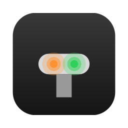
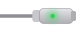
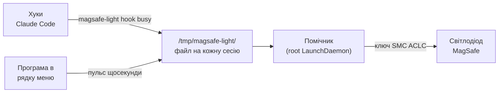

<div align="center">



# MagSafe Light

**Кабель MagSafe як індикатор AI-агента.**

Одним поглядом на зарядний кабель видно, чи Claude Code працює, чекає на тебе або вже закінчив.

[](https://github.com/onelenyk/magsafe-light/actions/workflows/build.yml)
[](https://github.com/onelenyk/magsafe-light/releases/latest)
[](LICENSE)


[English](README.md) · **Українська**

</div>

---

| Світло | Що означає |
|:---:|---|
|  | **Працює**: агент виконує задачу |
|  | **Чекає на тебе**: запит дозволу або питання |
|  | **Помилка**: хід завершився невдало |
|  | **Готово**: 10 хвилин, потім знову звичайна індикація |
|  | **Немає активних сесій**: macOS показує зарядку як завжди |

Якщо агентів кілька, показується найважливіший стан: помилка › чекає › працює › готово.

Апаратно світлодіод уміє лише зелений, помаранчевий і «вимкнено», тож інших кольорів немає.

## Встановлення

```sh
curl -fsSL https://raw.githubusercontent.com/onelenyk/magsafe-light/main/get.sh | sh
```

Команда завантажує останній реліз, перевіряє контрольну суму, кладе **MagSafe Light** у «Програми» і запускає. Під час першого запуску програма запропонує два кроки:

1. **Встановити помічника.** Пароль потрібен один раз ([чому](#як-це-влаштовано)).
2. **Підключити Claude Code.** Додасть хуки в `~/.claude/settings.json`, не чіпаючи інших.

От і все: у рядку меню з'являється іконка, а кабель починає показувати, що робить агент.

**Що потрібно:** Mac з MagSafe 3 (MacBook Air M2 і новіші, MacBook Pro 14″/16″ з 2021 року), macOS 13 або новіша.

<details>
<summary><b>Чому команда в терміналі, а не посилання на завантаження?</b></summary>

MagSafe Light безкоштовна і не підписана платним сертифікатом Apple Developer ID. Програми, завантажені браузером, macOS позначає карантином і непідписані блокує. Файли, завантажені через `curl`, під карантин не потрапляють, тому програма просто відкривається.

Якщо хочеш завантажити [`MagSafe-Light.zip`](https://github.com/onelenyk/magsafe-light/releases/latest) вручну: відкрий програму, macOS її заблокує, далі **Системні параметри → Конфіденційність і безпека → Все одно відкрити**. Або одна команда:

```sh
xattr -dr com.apple.quarantine "/Applications/MagSafe Light.app"
```
</details>

<details>
<summary><b>Зібрати самому</b></summary>

```sh
git clone https://github.com/onelenyk/magsafe-light.git && cd magsafe-light
make install-app      # потрібні Xcode Command Line Tools
```
</details>

<details>
<summary><b>Видалити</b></summary>

```sh
curl -fsSL https://raw.githubusercontent.com/onelenyk/magsafe-light/main/get.sh | sh -s -- uninstall
```

Прибирає хуки, помічника і програму, а світлодіод повертає macOS.
</details>

## Програма в рядку меню

Іконка в рядку меню показує поточний стан. У меню є:

- стан світлодіода і всі активні сесії агентів;
- **Увімкнено**: вимкни, і світлодіод знову показуватиме зарядку як завжди;
- **Тест світлодіода**: проганяє всі стани, по 3 секунди на кожен;
- **Хуки Claude Code**: підключити або відключити;
- **Помічник**: перевстановити або видалити;
- **Запускати при вході**, **Про MagSafe Light**, **Вийти**.

Світлодіод показує стан агентів, тільки поки програма працює й увімкнена. Якщо її закрити, за пару секунд кабель знову показує звичайну зарядку.

## Як це влаштовано



Світлодіодом керує SMC, контролер живлення мака, через незадокументований ключ `ACLC`:

| Значення | Що робить |
|:---:|---|
| `0` | керує macOS |
| `1` | вимкнений |
| `3` | зелений |
| `4` | помаранчевий |

Писати в SMC може лише root, а хук агента не може щоразу питати пароль. Тому інструмент — це один C-бінарник без залежностей, який працює у двох ролях:

- **`magsafe-light hook <стан>`** викликають хуки агента, і root для цього не потрібен. Він бере `session_id` з JSON події на stdin і записує стан у файл. Нічого не виводить і завжди завершується з кодом 0, тож агента не гальмує й не ламає.
- **`magsafe-light daemon --require-app`** — помічник, працює від root. Кожні пів секунди вибирає найважливіший стан серед сесій і керує світлодіодом, зокрема блиманням. Поки є свіжий пульс програми, він раз на 5 секунд записує свій колір знову, бо macOS може його перебити (наприклад, коли змінюється стан зарядки).

Стан без оновлень прострочується: «працює» через 20 хвилин, «чекає» через годину, «готово» і «помилка» через 10 хвилин. Так світлодіод не застрягне, якщо агент упав.

### Події Claude Code

| Стан | Події |
|---|---|
| працює | `UserPromptSubmit`, `PostToolUse`, `PostToolUseFailure`, `PermissionDenied`, `ElicitationResult`, `PreCompact` |
| чекає | `PermissionRequest`, `PreToolUse` (AskUserQuestion), `Elicitation`, `Notification` (дозвіл чи питання) |
| готово | `Stop` |
| помилка | `StopFailure` |
| спокій | `SessionEnd` |

Інші агенти підключаються так само: їхній хук викликає `magsafe-light hook <стан>` і передає подію на stdin. Ідентифікатор сесії береться з поля `session_id` або `sessionId`.

## Командний рядок

```sh
magsafe-light status            # сесії і що зараз показує світлодіод
magsafe-light set busy          # вручну задати стан (сесія manual)
magsafe-light set idle          # прибрати її
magsafe-light clear             # прибрати всі сесії
sudo magsafe-light led 3        # записати ACLC напряму
sudo magsafe-light blink 3      # тест: зелений, помаранчевий, вимкнений
```

Стани: `busy`, `waiting`, `done`, `error`, `idle` (прибирає сесію), `notification` (те саме, що `waiting`).

Хочеш без програми в рядку меню? `./install.sh` ставить помічника, який працює завжди, а `./install-hooks.sh claude` додає хуки.

## Чи це безпечно?

- Програма пише лише в один ключ SMC, `ACLC`, і лише значення 0–7. Це тільки індикація, на зарядку вона не впливає.
- Нічого не зберігається після перезавантаження. Якщо щось не так: `sudo magsafe-light led 0` або перепідключи кабель.
- Ключ не задокументований Apple. Значення взято з open-source проєктів і перевірено на M4 Pro; майбутнє оновлення macOS може їх змінити.
- Будь-який процес на цьому маку може записати стан у `/tmp/magsafe-light` і так змінити колір світлодіода. Нічого іншого через це зробити не можна.

Подробиці про root-помічника: [SECURITY.md](SECURITY.md).

## Тести

| Тест | Що перевіряє | Де йде |
|---|---|---|
| `make test` | логіку станів без запису в SMC: пріоритет, прострочення, `idle`, імена сесій | на кожен коміт, GitHub Actions |
| `tests/e2e-claude.sh` | справжній Claude Code у tmux: запит → дозвіл на Bash → схвалення → кінець ходу → `/exit` | вручну, потрібен вхід у Claude |
| `tests/e2e-app.sh` | справжні кліки по меню програми через System Events | вручну, потрібен дозвіл Accessibility |

Останній прогін `tests/e2e-claude.sh` (Claude Code 2.1.302, MacBook Pro M4 Pro, macOS 26.3):

```
01:12:22 none
01:12:25 busy       запит надіслано
01:12:27 waiting    Claude питає дозвіл на Bash
01:12:30 busy       дозвіл дано, команда виконується
01:12:31 done       кінець ходу
01:12:33 gone       /exit, сесію прибрано
ok   послідовність станів збігається
```

## Схожі проєкти

- [AgentLight](https://github.com/onelenyk/agentlight) — та сама ідея у вигляді настільної лампи на ESP32, з усіма кольорами.

## Ліцензія

[MIT](LICENSE) © onelenyk
